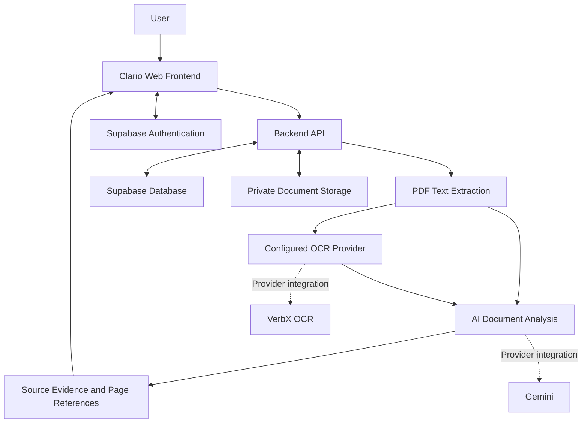

# Clario — AI-Powered Document Intelligence Agent

### Complex Documents. Clear Answers.

**Clario** is an AI-powered document intelligence platform designed to transform complex PDF documents into clear, evidence-based answers. It helps users explore documents, verify numerical information, compare content, identify potential contradictions, trace evidence, and evaluate document-based rules.

**Built for the ZIRO Agentic AI Hackathon 2026**

<p align="center">
  <a href="https://clario-navy.vercel.app/"><strong>Live Demo</strong></a> •
  <a href="https://github.com/Harini09062006/Clario"><strong>GitHub Repository</strong></a>
</p>

<p align="center">
  
  
  
</p>

---

## Table of Contents

- [Overview](#overview)
- [Problem Statement](#problem-statement)
- [Our Solution](#our-solution)
- [Key Features](#key-features)
- [What Makes Clario Different](#what-makes-clario-different)
- [How It Works](#how-it-works)
- [System Architecture](#system-architecture)
- [Technology Stack](#technology-stack)
- [Getting Started](#getting-started)
- [Environment Configuration](#environment-configuration)
- [Running the Project](#running-the-project)
- [Deployment](#deployment)
- [Security and Reliability](#security-and-reliability)
- [Limitations](#limitations)
- [Future Roadmap](#future-roadmap)
- [Team](#team)
- [Contributing](#contributing)
- [Acknowledgements](#acknowledgements)
- [License](#license)

---

## Overview

Documents such as scholarship guidelines, policies, contracts, reports, and official circulars often contain important information spread across many pages. Finding the right information is time-consuming, and verifying whether an answer is supported by the original document can be difficult.

Clario aims to simplify this process through a unified document intelligence workspace.

Instead of treating a PDF as ordinary text, Clario focuses on connecting document analysis with evidence. Users can ask questions, inspect source passages, compare documents, check numerical claims, investigate potential contradictions, and evaluate rules using information from their documents.

**Our vision:** Move from lengthy documents to understandable answers and traceable evidence.

## Problem Statement

Traditional document review presents several challenges:

- **Information overload:** Important requirements and conditions are buried in lengthy documents.
- **Manual verification:** Checking figures, deadlines, and eligibility criteria takes time.
- **Scattered evidence:** Answers may be difficult to trace to their original pages.
- **Document inconsistencies:** Conflicting statements across documents can be overlooked.
- **Scanned PDFs:** Image-only documents require OCR before their contents can be searched.
- **Decision complexity:** Applying multiple document rules to a specific situation can be difficult.

## Our Solution

Clario combines document question answering with verification and evidence-traceability tools in one workspace.

The platform is designed to help users:

1. Upload and process PDF documents.
2. Ask natural-language questions about document contents.
3. Review answers alongside source passages and page references.
4. Compare information across documents.
5. Verify numerical information and calculations.
6. Investigate potentially conflicting statements.
7. Trace claims to supporting evidence.
8. Evaluate user inputs against rules found in documents.

Clario is intended to support human decision-making, not replace professional judgment or official decisions.

## Key Features

### 1. Ask Documents

Ask questions about uploaded PDFs using natural language.

The goal is to provide relevant answers grounded in the uploaded content, with source passages and page-level citations where supported.

**Use cases:** Understanding eligibility criteria, finding deadlines, locating requirements, and summarizing important conditions.

### 2. My Documents

Access and manage uploaded documents through the document workspace.

Document persistence depends on the configured authentication, database, and storage integrations.

### 3. Compare Documents

Compare multiple documents to identify relevant differences in requirements, dates, amounts, wording, and other important information.

Comparisons should be reviewed against the original source passages before decisions are made.

### 4. Verify Numbers

Inspect numerical claims and check calculations against document evidence.

This feature is intended to help identify discrepancies and make numerical information easier to audit.

### 5. Contradiction Radar

Investigate potentially conflicting statements, dates, financial amounts, and requirements.

A detected difference is not necessarily a true contradiction: statements may apply to different circumstances, versions, or eligibility categories. Findings should therefore be reviewed in context.

### 6. Evidence Graph

Trace answer claims to their supporting passages and original document pages.

This provides a way to inspect where an answer came from instead of relying solely on the generated response.

### 7. Decision Simulator

Evaluate user-provided information against rules extracted from documents.

Where implemented, the simulator presents individual rule outcomes and supporting evidence to help users understand which conditions appear satisfied, unsatisfied, or require further review.

It does not guarantee eligibility, approval, or any official outcome.

### 8. Test Lab

Evaluate document-analysis workflows and test how the system responds to document questions and evidence-related tasks.

Actual test coverage and results should be reported only after running the corresponding tests.

### 9. PDF Text Extraction and OCR

Text-based PDFs can be processed using native text extraction. Scanned or image-only PDFs require a working OCR provider.

Clario's intended OCR integrations include Gemini and VerbX, subject to valid credentials, provider availability, and supported request formats.

**Important:** Successful scanned-PDF OCR depends on the production provider configuration. Do not assume OCR is operational for every document until it has been verified using genuine scanned PDFs.

---

## What Makes Clario Different?

Clario is designed to bring several document-analysis capabilities together instead of offering only basic PDF question answering.

| Capability | Value |
|---|---|
| Source-grounded answers | Helps users inspect the evidence behind an answer |
| Page-level citations | Makes it easier to verify information in the original PDF |
| Numerical verification | Helps review figures and calculations |
| Document comparison | Helps identify important differences across files |
| Contradiction Radar | Helps investigate potentially conflicting statements |
| Evidence Graph | Connects answer claims to their source passages |
| Decision Simulator | Helps evaluate document rules against user inputs |

The central design principle is **evidence before conclusions**. When information is missing, ambiguous, or unavailable, the system should communicate that limitation rather than inventing supporting evidence.

## How It Works

The intended workflow is:

1. **Upload:** The user uploads a PDF.
2. **Extract:** The backend extracts available text or invokes a configured OCR provider for scanned pages.
3. **Ask:** The user submits a natural-language question.
4. **Analyze:** The application processes the relevant document content.
5. **Answer:** The system generates a response using available source evidence.
6. **Verify:** The user can investigate numerical claims, document differences, and potential contradictions.
7. **Trace:** Evidence-traceability tools connect claims to relevant passages and pages.
8. **Evaluate:** The Decision Simulator helps assess document rules against user-provided inputs.
9. **Review:** The user checks the original evidence before acting.

The precise processing path depends on the document type, available provider configuration, and implemented feature.

## System Architecture

The following diagram illustrates the intended high-level architecture. Confirm each integration against the current implementation before treating the diagram as a complete representation of production behavior.



### Architecture Responsibilities

- **Frontend:** Provides the document workspace and user-facing analysis features.
- **Backend:** Handles supported API requests and server-side processing.
- **Supabase:** Provides configured authentication, database, and document-storage services.
- **AI and OCR providers:** Support document analysis and scanned-page extraction when correctly configured.
- **Evidence layer:** Connects generated answers and analysis results to source material where supported.

This diagram represents the intended design. The active data flow, security controls, and provider integrations should be confirmed against the source code and deployed configuration.

## Technology Stack

The project uses or is intended to use the following technologies, subject to verification against the current repository.

| Technology | Purpose |
|---|---|
| React | Frontend user interface |
| TypeScript | Application development with type checking |
| Vite | Frontend development and build tooling |
| Node.js | Backend runtime |
| Express.js / Node APIs | Backend request handling, where configured |
| Supabase | Authentication, database, and document storage |
| Gemini | AI processing, where configured |
| VerbX | OCR and related provider integrations, where configured |
| Vercel | Frontend hosting |
| Render | Backend hosting |

## Getting Started

### Prerequisites

Install the tools required by the current project configuration:

- Git
- Node.js and npm, using versions compatible with the repository
- A Supabase project if authentication, persistence, or storage is required
- Valid provider credentials for AI or OCR features that depend on external services

### 1. Clone the Repository

```bash
git clone https://github.com/Harini09062006/Clario.git
cd Clario
```

### 2. Install Dependencies

```bash
npm install
```

If the backend uses a separate package directory or installation process, follow the scripts and instructions defined in the repository.

### 3. Configure Environment Variables

Inspect `.env.example` and create the appropriate local environment files.

For example:

```bash
cp .env.example .env
```

On Windows PowerShell, use:

```powershell
Copy-Item .env.example .env
```

Only create the files required by the actual project. Populate them with your own valid configuration values.

### 4. Start the Development Server

Use the development command defined in `package.json`. For a Vite application, this is commonly:

```bash
npm run dev
```

If the backend runs separately, open another terminal and use the backend's configured development command.

### 5. Build for Production

```bash
npm run build
```

The build command and output directory must match the repository's actual configuration.

---

## Environment Configuration

The exact environment variables must be taken from `.env.example` and the source code. The following table describes the expected configuration categories; confirm the actual variable names before deployment.

| Variable | Purpose | Where it belongs |
|---|---|---|
| `VITE_API_BASE_URL` | Public base URL for the frontend's backend API requests, if used | Vercel and local frontend environment |
| `VITE_SUPABASE_URL` | Supabase project URL for browser-side integration | Vercel and local frontend environment |
| `VITE_SUPABASE_ANON_KEY` | Public Supabase browser key, if this variable is used by the app | Vercel and local frontend environment |
| `SUPABASE_URL` | Supabase project URL for server-side access | Render |
| `SUPABASE_SERVICE_ROLE_KEY` | Privileged Supabase server credential, if required by the backend | Render only |
| `GEMINI_API_KEY` | Gemini API authentication | Render only when called by the backend |
| `VERBX_API_KEY` | VerbX API authentication | Render only when called by the backend |
| `VERBX_OCR_ENDPOINT` | Configured VerbX OCR endpoint, if read by the code | Render |
| `VERBX_TRANSLATION_ENDPOINT` | Translation endpoint, if used | Render |
| `VERBX_CHAT_ENDPOINT` | Chat endpoint, if used | Render |
| `VERBX_STT_ENDPOINT` | Speech-to-text endpoint, if used | Render |
| `VERBX_TTS_ENDPOINT` | Text-to-speech endpoint, if used | Render |

**Security rules:**

- Never commit `.env` files or real API credentials.
- Never expose Gemini, VerbX, or Supabase service-role secrets through `VITE_*` variables.
- Browser-exposed variables must be treated as public.
- Use protected environment settings in Vercel and Render.
- Configure only the variables actually required by the application.
- Never disable database security policies simply to make deployment work.

---

## Deployment

### Frontend — Vercel

Live application: [https://clario-navy.vercel.app/](https://clario-navy.vercel.app/)

The frontend should be connected to the GitHub repository and configured with the appropriate build settings and public frontend environment variables.

If the frontend calls a separately hosted backend, configure the correct backend URL through the environment variable used by the application and redeploy.

### Backend — Render

Deploy the Node.js backend as a web service using the repository's actual build and start commands.

Configure:
- Required server-side environment variables.
- The appropriate port binding.
- CORS for the deployed frontend origin.
- Provider credentials through protected settings.
- Health checks and runtime logging where supported.

Do not assume that the backend is live or that every endpoint works without verifying the deployed service.

### Database and Storage — Supabase

Configure the existing Supabase project for the application's actual authentication, database, and document-storage requirements.

Verify:
- Database schema and migrations.
- Authentication configuration.
- Row Level Security policies.
- Document ownership and access controls.
- Private storage permissions.
- Correct persistence after refreshing or signing in again.

The application should preserve document privacy and restrict users to the records they are authorized to access.

---

## Testing and Validation

Test the application with representative documents and realistic failure conditions.

| Test | What to verify |
|---|---|
| Text-based PDF upload | The document is processed and its text is available |
| Document Q&A | The response matches the document and cites relevant pages |
| Numerical verification | The calculation and source values are correct |
| Document comparison | Reported differences match the source documents |
| Contradiction detection | Findings are supported by passages and interpreted in context |
| Evidence Graph | Claims connect to real source passages and pages |
| Decision Simulator | Rule outcomes match the configured document criteria |
| Scanned PDF | A genuine image-only PDF is processed by a working OCR provider |
| Authentication | Users can access only their authorized documents |
| Persistence | Uploaded documents remain available after a new session |
| Provider failure | Errors are clear and no fabricated extraction is returned |

Run the test scripts provided in the repository. Do not report a test as passed unless it has actually been executed and verified.

## Security and Reliability

Clario handles potentially sensitive document content, so reliability and access control matter.

- Keep privileged API keys on the backend.
- Use authenticated access and database policies where configured.
- Keep uploaded documents private unless public access is explicitly intended.
- Validate uploads and incoming API requests.
- Avoid logging API keys, tokens, or sensitive document contents.
- Provide meaningful errors when external providers fail.
- Preserve accurate source references and page numbers.
- Treat AI-generated answers as interpretations that should be checked against the source document.
- Do not present an automated eligibility assessment as an official decision.

## Limitations

The application depends on the quality of the uploaded documents, extraction results, AI responses, and external service availability.

- Scanned PDFs require a working OCR provider.
- OCR availability depends on valid credentials, supported request formats, and provider availability.
- Poor-quality scans can produce incomplete or incorrect text.
- Potential contradictions require contextual review.
- Missing information must be distinguished from information that has been verified.
- Decision-support results do not guarantee eligibility, approval, or legal or financial outcomes.

Current production readiness should be assessed through actual end-to-end testing.

## Future Roadmap

Potential areas for further improvement include:

- More reliable OCR fallback and clearer provider diagnostics.
- Stronger evaluation of citation accuracy and answer grounding.
- Improved handling of large and multilingual documents.
- More robust document version comparison.
- Expanded automated regression tests.
- Better evidence visualization and document navigation.
- Improved error reporting and production monitoring.

These items represent potential improvements rather than a claim that they are already implemented.

## Team

**Team Innovatrix**

- **Harini R**
- **Vaishnavi S**

Built for the **ZIRO Agentic AI Hackathon 2026**.

## Contributing

Contributions and suggestions are welcome.

1. Fork the repository.
2. Create a feature branch.
3. Make a focused change.
4. Run the relevant tests.
5. Open a pull request describing the change and its validation.

Please avoid committing secrets, private documents, or unrelated changes.

## Acknowledgements

We thank **ZIRO** for the opportunity to develop and present a practical AI-powered project.

We also acknowledge the developers and maintainers of the technologies and services used in the application.

## License

Check the repository for an existing `LICENSE` file before distributing or reusing this project. If no license is present, the project's reuse terms have not been explicitly granted.

---

<p align="center">
  <strong>Clario — Complex Documents. Clear Answers.</strong><br/>
  From document ingestion to evidence-based decisions.
</p>

<p align="center">
  <a href="https://clario-navy.vercel.app/">Open Clario</a> ·
  <a href="https://github.com/Harini09062006/Clario">Explore the Repository</a>
</p>
